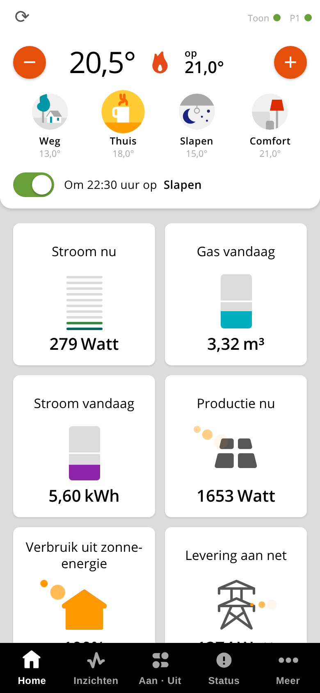
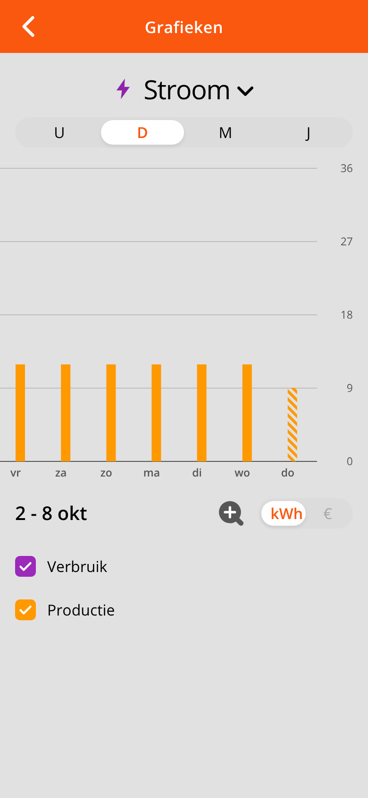
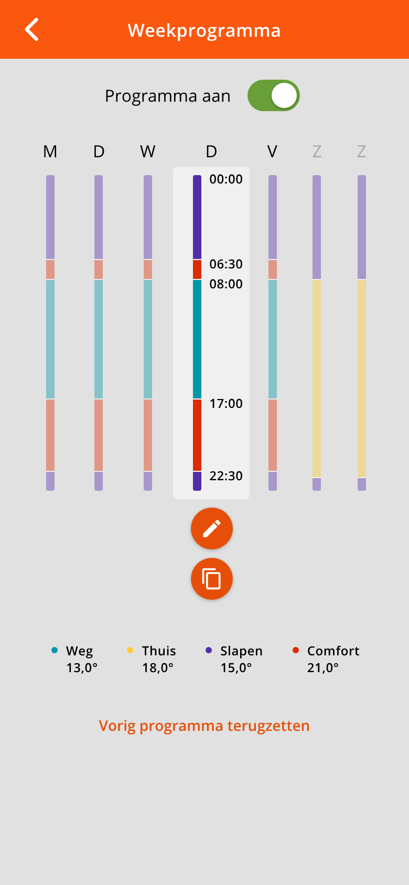
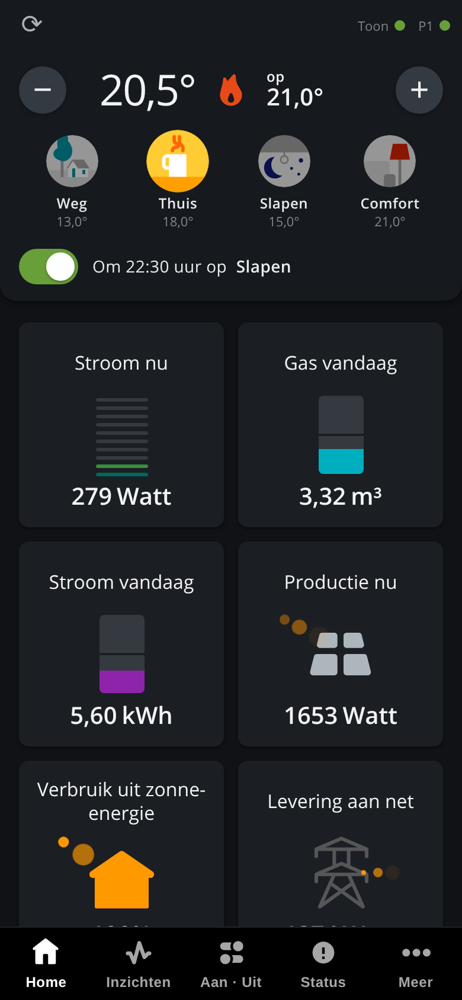

# Toon Mobile Rooted

Een mobiele interface voor je **Toon-thermostaat**, in de stijl van de officiële Toon-app, die **rechtstreeks met de Toon praat**. Je hebt geen Home Assistant, cloud of extra server nodig: de Toon levert zelf thermostaat, stroom, zonnepanelen, gas en grafieken. Er is een **Android-app (APK)** en dezelfde interface als **webpagina op de Toon** (`http://<toon>/mobile/`), ook als web-app op je beginscherm.

## Alleen voor geroote Toons

> **Dit project werkt alleen op een Toon die al is geroot.** Een standaard (niet-geroote) Toon laat geen eigen software toe; zonder root-toegang (SSH/telnet naar de Toon) kun je niets hiervan installeren.
>
> **Laat je Toon rooten door een professionele rooter.** Rooten grijpt diep in op de Toon en kan, als het fout gaat, de Toon onbruikbaar maken (en de garantie/het abonnement raken). Laat dat doen door iemand die het vaak doet, bijvoorbeeld een ervaren en betrouwbare rooter zoals [Sunny op Marktplaats](https://www.marktplaats.nl/v/doe-het-zelf-en-verbouw/thermostaten/a1434674516-toon-1-2-thermostaat-rooten-gebruiken-zonder-abonnement). In deze repo staat daarom **geen** uitleg over rooten.
>
> Gebruik op eigen risico. Dit is een hobbyproject en geen product van Eneco, Quby of Toon.

## Wat kan het?

- **Thermostaat**: huidige en gewenste temperatuur, omhoog/omlaag, presets (Comfort, Thuis, Slapen, Weg) en programma aan/uit.
- **Tegels met balken** zoals in de Toon-app: stroom nu, stroom vandaag, productie (zonnepanelen) nu en vandaag, afname/teruglevering en gas. De dagtotalen komen uit de echte tellers van de P1-module, niet uit een schatting.
- **Zonnepanelen en gas automatisch herkend**: Instellingen kent Auto / Ja / Nee. Heb je ze niet, dan verschijnen die tegels niet.
- **Grafieken** per uur, dag, maand en jaar (stroom, productie, gas), optioneel met tarieven in euro's. Staat een dagstaaf op de verkeerde dag, dan is er een dag-verschuiving.
- **Weekprogramma (Meer > Programma)**: het weekschema bekijken en **bewerken**: blokken toevoegen, wijzigen of verwijderen, een dag kopiëren en het vorige programma terugzetten. Elke wijziging maakt eerst een back-up en wordt gecontroleerd. Zie _Programma en vakantiestand_.
- **Vakantiestand (Meer > Vakantie)**: een periode instellen met een vaste temperatuur (standaard 15°, minimaal 6°), net als in de originele app. Op Home staat dan een banner "Vakantiestand tot …" met een knop om hem direct uit te zetten. Daarna gaat de Toon vanzelf verder met het weekprogramma.
- **Aan/Uit**: de echte schakelbare slimme stekkers van je Toon (alleen echte schakelaars in de lijst).
- **Status > Gegevenscontrole**: toont per bron wat de Toon teruggeeft, handig als een getal niet klopt.
- **Licht, donker of automatisch** (volgt je telefoon).
- **Verversen**: automatisch elke 5 seconden, plus een verversknop.
- **Beveiligd gebruik van buitenaf**: de app kent Cloudflare Access (service token, bewaard versleuteld in de Android Keystore).

## Zo ziet het eruit

<p>




</p>

Meer schermen (Aan/Uit, Status, Meer, Programma bewerken; licht en donker): [overzicht](docs/screenshots/overzicht.png). De schermen zijn gemaakt met nagebootste gegevens.

## Wat zit erin?

| Onderdeel | Bestand | Waarvoor |
|---|---|---|
| Android-app | `releases/2.0.0/toon-mobile-p1-2.0.0.apk` | Toon-interface als app, voor Android 6 of nieuwer |
| Toon-pakket | `releases/2.0.0/tsctoonmobilep1_2_0_0-r0_all.ipk` | zet de webinterface op de Toon (optioneel: de app werkt ook zonder) |

Eén versienummer voor app en pakket: nu **2.0.0**.

## Installeren op de Toon

Dit vergt SSH-toegang tot je geroote Toon. Zet het `.ipk`-bestand op de Toon (bijv. in `/tmp`) en voer uit:

```sh
opkg remove tsctoonmobilep1        # alleen nodig als er al een gelijke of oudere versie staat
opkg install tsctoonmobilep1_2_0_0-r0_all.ipk
```

Open daarna `http://<ip-van-de-toon>/mobile/`.

Verwijderen: `opkg remove tsctoonmobilep1` (de inlog-instelling wordt dan teruggezet).

## Installeren van de Android-app

1. Zet `toon-mobile-p1-2.0.0.apk` op je telefoon en open hem (sta installatie uit onbekende bronnen toe als Android erom vraagt).
2. Vul bij de eerste start het adres van de Toon in (`http://<ip>` thuis of je eigen `https://`-adres van buiten) en de gebruikersnaam en het wachtwoord van de Toon.
3. Gebruik je Cloudflare Access, vul dan ook het Client-ID en -Secret van je service token in.

De APK is ondertekend met een eigen sleutel; de sleutel zit **niet** in deze repo.

## Update-melding

De Android-app leest bij het starten (en bij terugkomen in de app, hooguit elke 30 minuten) het kleine bestand [`version.json`](version.json) uit deze repo. Staat daar een hoger versienummer dan dat van de app, dan verschijnt bovenin een balk met een knop om de nieuwe APK te downloaden (met een kruisje om hem weg te klikken; bij de volgende start komt hij terug); installeren doe je zelf. Uitzetten kan onder Meer > Over deze app. Wie een nieuwe release maakt, past `version` en `apk` in `version.json` aan.

## Beveiliging

- **Advies:** zet poort 80 van de Toon niet open op het internet. We raden aan om de Toon van buitenaf te bereiken via een **Cloudflare-tunnel met Cloudflare Access**; zo hoeft er geen poort open en kom alleen jij erin.
- Het pakket zet een **inlog op `/mobile`** (dezelfde gebruiker en hetzelfde wachtwoord als de Toon, `/qmf/etc/lighttpd/lighttpd.user`). Van `lighttpd.conf` wordt een back-up gemaakt; start de webserver niet meer, dan wordt automatisch teruggezet. Stond de inlog er al, dan verandert er niets.
- Wachtwoorden en tokens in de app staan versleuteld in de Android Keystore.

## Programma en vakantiestand

De app zet het weekschema en de vakantiestand **rechtstreeks** op de Toon (via `/hcb_config`) en controleert daarna altijd het resultaat: het schema moet worden teruggelezen én de thermostaat moet het in gebruik nemen. Op recente Toon 2-software (getest op 6.4.5 en op een echte Toon 2) werkt dat zonder iets extra's op de Toon. Een back-up van het vorige programma bewaart de app op je telefoon ("Vorig programma terugzetten"). Het Toon-pakket (`.ipk`) is alleen nodig voor de webinterface op de Toon zelf; de Android-app werkt ook zonder.

Neemt een Toon wijzigingen op deze manier niet aan (mogelijk op oudere software), dan blijft het Programma-scherm alleen om te bekijken en stel je programma en vakantiestand op de Toon zelf in. Met `tools/toon-diag-http.sh` (op de Toon uitvoeren) test je in een minuut of jouw Toon het aanneemt; het zet het programma tijdelijk om en daarna weer terug.

## Zelf bouwen

```sh
tools/build-ipk.sh p1          # opkg-pakket
```

De broncode van de Android-app (een kale WebView-schil rond dezelfde webinterface) staat niet in deze repo; de gebouwde APK staat in `releases/`. Test: `tools/model_test.js` (weekprogramma-model), `tools/mock.py` (nagebootste Toon).

## Indeling

```
p1/package/   opkg-pakket (c = control/scripts, d = bestanden)
tools/        bouw- en testscripts, pictogrammen
releases/     gebouwde .apk en .ipk per versie
```

## Disclaimer

- Dit is een hobbyproject. De software wordt geleverd **zoals ze is, zonder enige garantie**, en het gebruik is **volledig op eigen risico**. De maker is niet aansprakelijk voor schade, zoals een onbruikbare Toon, een verkeerd weekprogramma, verlies van gegevens of een beveiligingsincident.
- Je bent zelf verantwoordelijk voor de beveiliging van je Toon en je netwerk, en voor wat je met de software doet.
- Niet verbonden aan, goedgekeurd door of gesponsord door Eneco, Quby of Toon. "Toon" is een merk van de rechthebbende.
- Licentie: [MIT](LICENSE). Onderdelen van derden (lettertypen, pictogrammen): zie [NOTICE](NOTICE).

Wijzigingen: zie [CHANGELOG.md](CHANGELOG.md).
